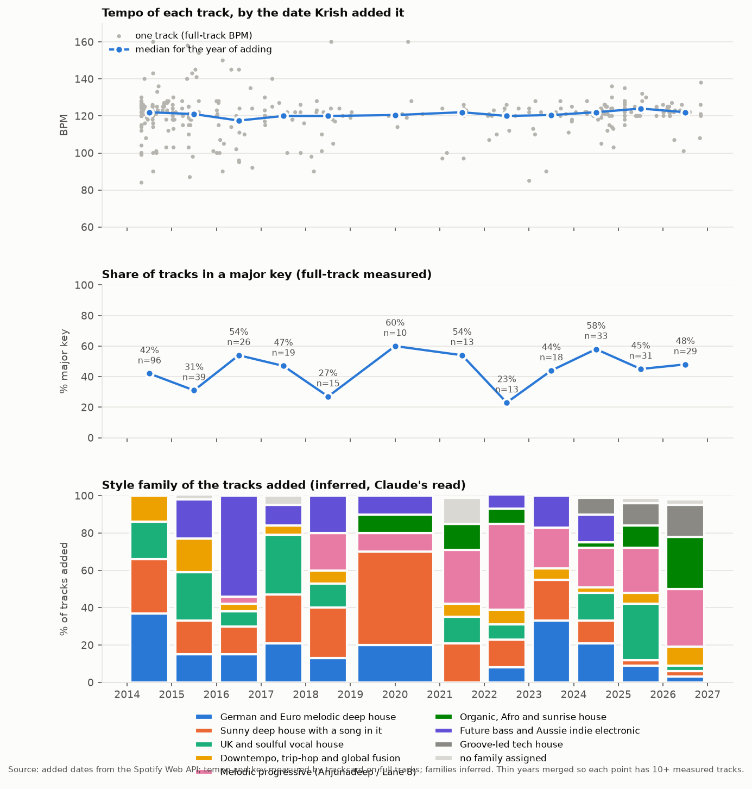

# How Krish's taste moved, 2014-2026

The playlist "Chillout & Ambient" holds 346 tracks, added between 28 April 2014 and 7 November 2026 (Spotify Web API,
`added_at`, read 2026-11-13 with Krish's login). 342 are measured by trackcard on the full track (no stems; Laplacian
sections). 4 have no audio (see the end). Style families are inferred: my read of the artists, in `families.json`.

Periods are years of adding. Quarters are too thin: only 11 of 46 quarters hold 10 or more tracks. 2019 (4 tracks) and 2020
(6) are merged so every period has at least 10 measured tracks. 2014 is the playlist's first build, when 97 tracks went in,
so it shows his taste up to 2014 rather than a change during that year.

## The headline

**The tempo held and tightened. The style moved from German melodic deep house to melodic progressive and organic house.
The mode moved only a little towards major.** In numbers, by era of adding (measured on full tracks unless marked):

| added | tracks | median BPM | share at 120-126 BPM | major | length | bars before full energy | leading families (inferred) |
|---|---|---|---|---|---|---|---|
| 2014 (first build) | 97 | 122 | 62% | 42% | 5:36 | 16 | German melodic deep 37%, sunny vocal deep 29%, UK soulful 20% |
| 2015-2018 | 99 | 120 | 35% | 39% | 4:10 | 12 | future bass / Aussie indie 27%, UK soulful 20%, sunny vocal deep 20% |
| 2019-2023 | 55 | 121 | 63% | 44% | 4:52 | 16 | melodic progressive 27%, sunny vocal deep 25%, German melodic deep 16% |
| 2024-2026 | 95 | 122 | 73% | 51% | 4:02 | 10 | melodic progressive 25%, UK soulful 17%, organic / Afro 14%, groove tech house 13% |

Length is Spotify's duration over all tracks. The era rows were computed from `tracks.csv` with the same rules as the yearly
table below.

What moved, in order of how clear the numbers are:

1. **Tempo is the constant.** The yearly median sits between 117.5 and 124 BPM in every period. What changed is the spread.
   2015-2018 wandered: future bass and Aussie indie electronic ran from 100 to 158 BPM, and only 35% of tracks sat at
   120-126. Since 2024, 73% sit at 120-126, the tightest of any era. My read: the 2015-2018 detour into Chet Faker, Flume,
   Hayden James and SAFIA was real, and he came back to house tempo and stayed.
2. **The family mix turned over.** German and Euro melodic deep house (Kalkbrenner, Klangkarussell) fell from 37% of 2014's
   tracks to 3% of 2026's. Melodic progressive (Anjunadeep, Lane 8, Ben Böhmer) went from 0% in 2014 and 2015 to first or
   second place in every year since 2021, and first in 2021, 2022 and 2026. Organic, Afro and sunrise house was 0% up to
   2018 and is 28% of 2026's additions. Groove-led tech house appears only from 2024 (9%, 12%, 17%).
3. **Tracks got shorter and reach full energy sooner.** The median length fell from 5:36 (2014) to 4:02 (2024-2026). The
   bars before the first full-energy section went 16, 12, 16, then 10. My read: more radio and single edits and fewer club
   extended mixes. That may be the versions Spotify serves rather than a change of taste, so check before relying on it.
4. **Mode moved little, and not steadily.** The major share swings between 23% and 60% from year to year with no clean
   trend (2022: 23%, 2024: 58%). Across the eras it goes from 42% to 51%. That is a lean towards major, not a switch.
5. **The sound did not change.** At era level, the air band stays near -20 dB, the crest at 11.4-12 dB and loudness near
   -10 LUFS. The warm, soft-topped, unsquashed master is as constant as the tempo.

## The tracks that mark each shift

Taken from the generated list at the end (the family that grew most in each period, and its first tracks added then):

- **2015-2016, the indie electronic detour:** Hayden James "Something About You" (2015-04-02), Chet Faker "Talk Is Cheap"
  (2015-05-06), Flume and Chet Faker "Drop the Game" (2015-05-11), SAFIA "Paranoia, Ghosts & Other Sounds" (2016-02-01).
- **2018, the first melodic progressive:** Above & Beyond, Alex Vargas and EDX "Blue Sky Action (EDX's Indian Summer
  Remix)" (2018-03-28), Kiasmos "Blurred" (2018-05-26).
- **2021-2022, melodic progressive takes the lead:** Ben Böhmer "Beyond Beliefs" (2021-07-17), Lane 8 and Massane "And We
  Knew It Was Our Time" (2022-06-15).
- **2024-2025, soulful and groove house come back:** Laid Back "Bakerman" (Soul Clap Remix, 2024-01-19), Barry Can't Swim
  "Rah That's A Mad Question" (2024-09-11), Dam Swindle "That's Right" (2025-02-21).
- **2026, organic and sunrise house:** Tube & Berger and Paji "Reliquia" (German Brigante Remix, 2026-01-05), Carlita
  "Time" (2026-02-20), Hugo Samba and Sounds Of Sirin "Blonde de Soleil" (2026-02-20).

## How this ties to the 2026 shares (`taste/references.json`)

Most of the tracks Krish and Calvin shared in 2026 (Spencer Brown, Sébastien Léger, Jody Wisternoff, Essáy, JAIV,
Kollektiv Turmstrasse) sit in the families that are rising in the playlist: melodic progressive and organic house. That
grouping is my read. Two of the shares are in the playlist: Kollektiv Turmstrasse "Sorry I Am Late" (added 2026-03-30) and
Essáy "Archangel" (added 2026-11-04).

The measured playlist backs the move towards organic and progressive material. On mode it is more cautious: 2024-2026
additions are 51% major, against 42% in 2014. That is a lean, not the clear major tilt the references were read as having.
trackcard has not measured the references, so their mode is a listening impression, not a measurement.

**For generation (my read, not an approved rule):** keep 122 BPM (120-126) and the warm sound every era shares: about -10
LUFS with an 11-12 dB crest. Take the style from the 2024-2026 rows: melodic progressive or organic house, about 4 minutes,
at full energy by bar 8-12. Treat major as an equal option, not the default.

## The numbers (generated by `chronology.py`; do not edit by hand)

<!-- numbers:start -->
| added in | tracks (measured) | median BPM (middle half) | major | top keys | air dB | crest dB | intro bars | at full energy | breakdowns | length | released (median) |
|---|---|---|---|---|---|---|---|---|---|---|---|
| 2014 | 97 (96) | 122 (120-125) | 42% | 6A (13), 8A (11), 10B (7) | -20 | 12 | 16 | 70% | 2 | 5:36 | 2013 |
| 2015 | 39 (39) | 121 (115-126) | 31% | 6A (5), 9A (4), 11A (3) | -19.6 | 11.8 | 10 | 73% | 2 | 4:09 | 2014 |
| 2016 | 26 (26) | 117.5 (101.5-127.2) | 54% | 8A (4), 6A (3), 5B (3) | -19.15 | 11.5 | 16 | 64% | 2 | 4:18 | 2014 |
| 2017 | 19 (19) | 120 (117-125) | 47% | 2B (2), 10B (2), 5A (2) | -20.8 | 12.1 | 10 | 68% | 2 | 4:06 | 2015 |
| 2018 | 15 (15) | 120 (105-124) | 27% | 6A (4), 5A (2), 9B (2) | -22.8 | 11.8 | 8 | 62% | 2 | 4:11 | 2016 |
| 2019-20 | 10 (10) | 120.5 (119-123.5) | 60% | 4A (2), 3B (2), 6A (1) | -16.9 | 11.1 | 24 | 59% | 2 | 4:11 | 2016 |
| 2021 | 14 (13) | 122 (110-123.5) | 54% | 10B (3), 8A (2), 4A (2) | -17.6 | 11.9 | 8 | 75% | 2 | 5:22 | 2016 |
| 2022 | 13 (13) | 120 (116-123.5) | 23% | 9A (2), 4A (2), 2A (2) | -20 | 11.7 | 16 | 68% | 2 | 5:11 | 2020 |
| 2023 | 18 (18) | 120.5 (112.5-124) | 44% | 8B (3), 4A (2), 9A (2) | -21.8 | 11.8 | 18 | 60% | 2 | 4:14 | 2020 |
| 2024 | 33 (33) | 122 (119.5-124) | 58% | 10B (5), 8B (3), 5B (3) | -22.2 | 11.2 | 12 | 67% | 2 | 3:44 | 2020 |
| 2025 | 33 (31) | 124 (120-126) | 45% | 6A (6), 5B (5), 4A (4) | -17.1 | 11.7 | 16 | 68% | 2 | 4:32 | 2020 |
| 2026 | 29 (29) | 122 (120-124.5) | 48% | 4A (4), 8B (3), 5B (3) | -21 | 11.6 | 8 | 69% | 2 | 3:56 | 2023 |

Style family of the tracks added, share of that period (inferred, Claude's read):

| added in | German and Euro melodic deep house | Sunny deep house with a song in it | UK and soulful vocal house | Downtempo, trip-hop and global fusion | Melodic progressive (Anjunadeep / Lane 8) | Organic, Afro and sunrise house | Future bass and Aussie indie electronic | Groove-led tech house | no family |
|---|---|---|---|---|---|---|---|---|---|
| 2014 | 37% | 29% | 20% | 14% | 0% | 0% | 0% | 0% | 0% |
| 2015 | 15% | 18% | 26% | 18% | 0% | 0% | 21% | 0% | 3% |
| 2016 | 15% | 15% | 8% | 4% | 4% | 0% | 54% | 0% | 0% |
| 2017 | 21% | 26% | 32% | 5% | 0% | 0% | 11% | 0% | 5% |
| 2018 | 13% | 27% | 13% | 7% | 20% | 0% | 20% | 0% | 0% |
| 2019-20 | 20% | 50% | 0% | 0% | 10% | 10% | 10% | 0% | 0% |
| 2021 | 0% | 21% | 14% | 7% | 29% | 14% | 0% | 0% | 14% |
| 2022 | 8% | 15% | 8% | 8% | 46% | 8% | 8% | 0% | 0% |
| 2023 | 33% | 22% | 0% | 6% | 22% | 0% | 17% | 0% | 0% |
| 2024 | 21% | 12% | 15% | 3% | 21% | 3% | 15% | 9% | 0% |
| 2025 | 9% | 3% | 30% | 6% | 24% | 12% | 0% | 12% | 3% |
| 2026 | 3% | 3% | 3% | 10% | 31% | 28% | 0% | 17% | 3% |

Tracks that mark each period (the family whose share grew most against the period before, and its first tracks added in that period):

- **2014**, German and Euro melodic deep house: Fritz Kalkbrenner - Right In The Dark (2014-04-28, 125 BPM, G minor); Fritz Kalkbrenner - Wes (2014-04-28, 128 BPM, F# major); Fritz Kalkbrenner - Layer Cake - Original Mix (2014-04-28, 125 BPM, D major)
- **2015**, Future bass and Aussie indie electronic, up 21 points: Hayden James - Something About You (2015-04-02, 115 BPM, A minor); Chet Faker - Talk Is Cheap (2015-05-06, 140 BPM, C minor); Flume, Chet Faker - Drop the Game (2015-05-11, 158 BPM, E minor)
- **2016**, Future bass and Aussie indie electronic, up 33 points: Tomas Barfod, Nina Kinert - November Skies (2016-01-17, 127 BPM, A minor); Chet Faker - 1998 (2016-01-26, 100 BPM, D# major); SAFIA - Paranoia, Ghosts & Other Sounds (2016-02-01, 107 BPM, A# minor)
- **2017**, UK and soulful vocal house, up 24 points: Duke Dumont - Be Here (2017-01-31, 123 BPM, F# major); Claptone - Heartbeat (feat. Nathan Nicholson) (2017-01-31, 120 BPM, A# minor); Michael Calfan - Treasured Soul - Radio Edit (2017-04-02, 125 BPM, D major)
- **2018**, Melodic progressive (Anjunadeep / Lane 8), up 20 points: Above & Beyond, Alex Vargas, EDX - Blue Sky Action - EDX's Indian Summer Remix (2018-03-28, 122 BPM, G major); Vessels - 4AM (2018-05-12, 101 BPM, G minor); Kiasmos - Blurred (2018-05-26, 122 BPM, F# minor)
- **2019-20**, Sunny deep house with a song in it, up 23 points: LVNDSCAPE - Himalaya (2019-01-01, 120 BPM, F minor); The Avener, Phoebe Killdeer - Fade Out Lines - The Avener Rework (2019-01-01, 119 BPM, C# major); Pascal Junior - Holdin' On (2019-01-11, 122 BPM, G minor)
- **2021**, Melodic progressive (Anjunadeep / Lane 8), up 19 points: MEHÍLOVE - Aspiration (2021-01-22, 124 BPM, D major); Dusky, Janai - It's Not Enough (2021-07-16, 123 BPM, G minor); Ben Böhmer - Beyond Beliefs (2021-07-17, 124 BPM, C# major)
- **2022**, Melodic progressive (Anjunadeep / Lane 8), up 17 points: Marsh, Amonita - There For Me - Amonita Extended Mix (2022-02-08, 121 BPM, E minor); Bow Anderson, Icarus - Heavy - Icarus Extended Remix (2022-03-19, 123 BPM, F minor); Lane 8, Massane - And We Knew It Was Our Time (2022-06-15, 124 BPM, D# minor)
- **2023**, German and Euro melodic deep house, up 25 points: Jan Blomqvist, Elena Pitoulis - More (2023-01-02, 124 BPM, G# major); Klangkarussell - Home (2023-02-04, 113 BPM, A major); Rhythm Masters, Klangfabrik, Harold van Lennep - Dayhunter - Harold van Lennep Remix (2023-02-19, 110 BPM, C major)
- **2024**, UK and soulful vocal house, up 15 points: Laid Back, Soul Clap - Bakerman - Soul Clap Remix (2024-01-19, 122 BPM, C major); Boston Bun - Missing You (2024-09-08, 126 BPM, G minor); Barry Can't Swim - Rah That's A Mad Question (2024-09-11, 121 BPM, A minor)
- **2025**, UK and soulful vocal house, up 15 points: Dam Swindle - That's Right - Edit (2025-02-21, 120 BPM, G minor); Voilaaa, Sir Jean, Patchworks - Spies Are Watching Me - Patchworks Remix (2025-02-21, 127 BPM, E major); Jupiter, A.N.D.Y. - One O Six (A.N.D.Y. Remix) - Mixed (2025-02-21, 120 BPM, F# major)
- **2026**, Organic, Afro and sunrise house, up 16 points: Tube & Berger, Paji, German Brigante - Reliquia - German Brigante Remix (2026-01-05, 120 BPM, G# minor); Carlita - Time (2026-02-20, 125 BPM, D# major); Hugo Samba, Sounds Of Sirin - Blonde de Soleil (2026-02-20, 122 BPM, E minor)
<!-- numbers:end -->

## Still missing

- 4 tracks have no audio: Milky Chance "Stolen Dance (FlicFlac Club Edit)", Set Mo "Comfort You (Extended Mix)", Crusy
  "Kiki", Shouse and Adam Ten "Sunrise (Adam Ten Remix)". No upload within 6 s of Spotify's length was found on SoundCloud
  or YouTube, and Set Mo's SoundCloud upload would not resolve.
- No stem separation in this pass: Demucs on this machine would need about 35 hours for all 342 tracks. 5 tracks have
  stems cards, and their drops are in the graph, labelled. Breakdown counts and full-energy shares come from the full mix.
- Spotify's API no longer returns record labels. 342 labels come from the ℗ line on the album page and are labelled as
  such; 4 have none.
